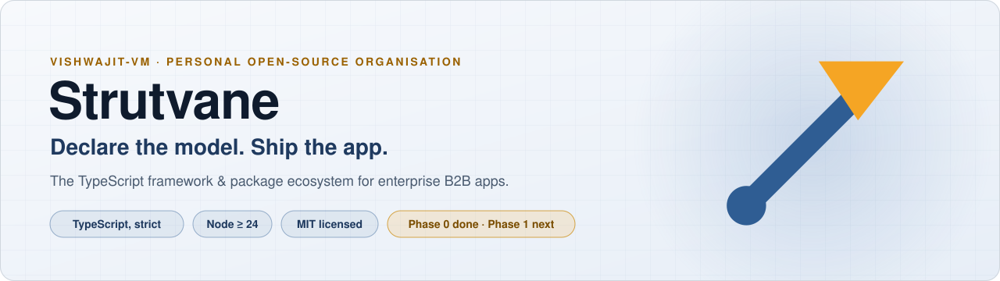
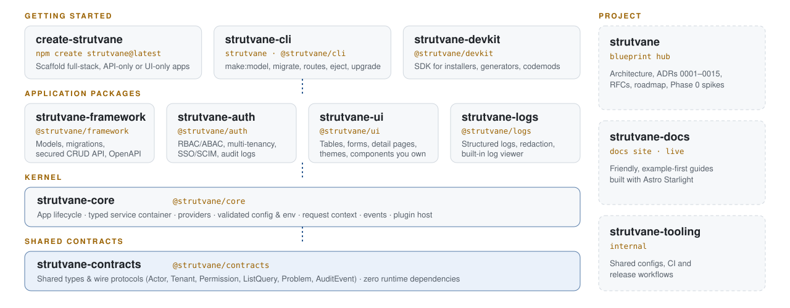

<a href="https://github.com/vishwajit-vm/strutvane">
  <picture>
    <source media="(prefers-color-scheme: dark)" srcset="assets/hero-dark.svg">
    <source media="(prefers-color-scheme: light)" srcset="assets/hero-light.svg">
    
  </picture>
</a>

<p align="center">
  <a href="https://vishwajit-vm.github.io/strutvane-docs/"><b>Documentation</b></a>
  &nbsp;&nbsp;|&nbsp;&nbsp;
  <a href="https://github.com/vishwajit-vm/strutvane"><b>Blueprint</b></a>
  &nbsp;&nbsp;|&nbsp;&nbsp;
  <a href="https://github.com/vishwajit-vm/strutvane/blob/main/docs/14-roadmap.md"><b>Roadmap</b></a>
  &nbsp;&nbsp;|&nbsp;&nbsp;
  <a href="https://github.com/vishwajit-vm/strutvane/blob/main/CONTRIBUTING.md"><b>Contributing</b></a>
</p>

<br>

**vishwajit-vm** is the open-source organisation of [Vishwajit VM](https://github.com/vishwajitvm). It hosts **Strutvane**, a TypeScript framework and package ecosystem for enterprise B2B applications: the admin panels, multi-tenant SaaS products and internal tools that every business needs, and that teams rebuild by hand for every project.

> [!NOTE]
> **Project status.** Phase 0 (foundations) is complete; Phase 1 (core, CLI and framework, targeting `0.1.0-alpha`) is next. The architecture blueprint, decision records (ADRs 0001–0015), RFCs and nine validation spikes (419 tests) are published. Shared tooling, the documentation site and the `@strutvane/contracts` v0 draft are built and tested. **No package has been released on npm yet**; the names there are reserved placeholders.

<br>

## Overview

Strutvane turns a model declaration into a working application. You describe your data as fields and types; one command produces the database migration, a secured and documented CRUD API, authentication with role-based access and multi-tenancy, and a complete user interface. The generated code is ordinary TypeScript that your team owns and can override at any level.

```ts
// app/models/invoice.model.ts — the complete definition
export default defineModel('Invoice', {
  number:   field.string().unique().searchable(),
  customer: field.belongsTo('Customer').filterable(),
  amount:   field.decimal(12, 2).min(0).sortable(),
  status:   field.enum(['draft', 'sent', 'paid']).default('draft').filterable(),
}, { timestamps: true, softDeletes: true, tenant: true, audit: true })
```

```bash
npm create strutvane@latest acme   # full-stack, API-only or UI-only
pnpm sv migrate                    # migration generated from the model and applied
pnpm dev                           # API at /api/v1/invoices, docs at /docs, UI at /invoices
```

The design target is a realistic B2B application, with 10–20 models, authentication, RBAC and a full interface, running in one to two hours.

<br>

## Architecture

<picture>
  <source media="(prefers-color-scheme: dark)" srcset="assets/ecosystem-dark.svg">
  <source media="(prefers-color-scheme: light)" srcset="assets/ecosystem-light.svg">
  
</picture>

Each package lives in its own repository and installs itself completely, including configuration, environment files, migrations, routes and screens. Packages never import one another. They interoperate only through a shared set of contracts, so any of them can be adopted, replaced or omitted on its own.

<br>

## Repositories

<table>
  <thead>
    <tr><th align="left">Layer</th><th align="left">Repository</th><th align="left">Description</th></tr>
  </thead>
  <tbody>
    <tr><td rowspan="3" valign="top"><b>Getting started</b></td><td valign="top"><a href="https://github.com/vishwajit-vm/create-strutvane"><b>create-strutvane</b></a><br><code>create-strutvane</code></td><td valign="top">Project scaffolding in one command, with full-stack, API-only and UI-only presets</td></tr>
    <tr><td valign="top"><a href="https://github.com/vishwajit-vm/strutvane-cli"><b>strutvane-cli</b></a><br><code>@strutvane/cli</code></td><td valign="top">Unified command line: models, resources, migrations, routes, permissions, eject and upgrade</td></tr>
    <tr><td valign="top"><a href="https://github.com/vishwajit-vm/strutvane-devkit"><b>strutvane-devkit</b></a><br><code>@strutvane/devkit</code></td><td valign="top">SDK for installers, generators, plugins and codemods, with transactional writes and dry-run diffs</td></tr>
    <tr><td rowspan="4" valign="top"><b>Application packages</b></td><td valign="top"><a href="https://github.com/vishwajit-vm/strutvane-framework"><b>strutvane-framework</b></a><br><code>@strutvane/framework</code></td><td valign="top">Backend and database core: models, migrations, secured CRUD API, OpenAPI, queues, cache and mail</td></tr>
    <tr><td valign="top"><a href="https://github.com/vishwajit-vm/strutvane-auth"><b>strutvane-auth</b></a><br><code>@strutvane/auth</code></td><td valign="top">Identity, RBAC/ABAC compiled to SQL, multi-tenancy with row-level security, audit logs, SSO and SCIM</td></tr>
    <tr><td valign="top"><a href="https://github.com/vishwajit-vm/strutvane-ui"><b>strutvane-ui</b></a><br><code>@strutvane/ui</code></td><td valign="top">Metadata-driven interface for Strutvane or any OpenAPI backend: tables, forms, detail pages and themes</td></tr>
    <tr><td valign="top"><a href="https://github.com/vishwajit-vm/strutvane-logs"><b>strutvane-logs</b></a><br><code>@strutvane/logs</code></td><td valign="top">Zero-configuration structured logging with rotation, secret redaction and a built-in log viewer</td></tr>
    <tr><td rowspan="2" valign="top"><b>Foundation</b></td><td valign="top"><a href="https://github.com/vishwajit-vm/strutvane-core"><b>strutvane-core</b></a><br><code>@strutvane/core</code></td><td valign="top">Kernel: application lifecycle, typed service container, providers, validated configuration, events and plugin host</td></tr>
    <tr><td valign="top"><a href="https://github.com/vishwajit-vm/strutvane-contracts"><b>strutvane-contracts</b></a><br><code>@strutvane/contracts</code></td><td valign="top">Shared types and wire protocols that let packages interoperate, with zero runtime dependencies</td></tr>
    <tr><td rowspan="3" valign="top"><b>Project</b></td><td valign="top"><a href="https://github.com/vishwajit-vm/strutvane"><b>strutvane</b></a></td><td valign="top">Blueprint hub: architecture, decision records, RFCs, roadmap and validation spikes</td></tr>
    <tr><td valign="top"><a href="https://github.com/vishwajit-vm/strutvane-docs"><b>strutvane-docs</b></a></td><td valign="top">Example-first documentation built with Astro Starlight, published at <a href="https://vishwajit-vm.github.io/strutvane-docs/">vishwajit-vm.github.io/strutvane-docs</a></td></tr>
    <tr><td valign="top"><a href="https://github.com/vishwajit-vm/strutvane-tooling"><b>strutvane-tooling</b></a></td><td valign="top">Canonical configuration, SHA-pinned CI and release workflows, and npm trusted publishing for every package</td></tr>
  </tbody>
</table>

Planned packages: `notify`, `files`, `payments`, `billing`, `reports`, `analytics`, `search`, `realtime` and `i18n`.

<br>

## Design principles

<table>
  <tr>
    <td width="50%" valign="top">
      <b>Owned code, not a black box</b><br>
      Four levels of control: declare, configure, override, eject. Adding a field never requires regenerating code.
    </td>
    <td width="50%" valign="top">
      <b>Enterprise features in the open core</b><br>
      RBAC, audit logging, multi-tenancy and SSO hooks are part of the MIT-licensed core, not a paid tier.
    </td>
  </tr>
  <tr>
    <td width="50%" valign="top">
      <b>Independent, composable packages</b><br>
      Adopt only what you need. Packages integrate through contracts rather than through each other.
    </td>
    <td width="50%" valign="top">
      <b>Honest database support</b><br>
      PostgreSQL first (including Azure, Neon, Supabase and RDS), followed by MySQL and SQLite, then SQL Server.
    </td>
  </tr>
</table>

<br>

## Roadmap

| Phase | Scope | Release |
|:--|:--|:--|
| **0** | Foundations: blueprint, decision records, RFCs, spikes, tooling, docs, contracts draft | **Complete** |
| **1** | Core, CLI and framework | `0.1.0-alpha` · next |
| **2** | Authentication and authorization | `0.2.0-alpha` |
| **3** | User interface | `0.3.0-alpha` |
| **4** | Enterprise layer | `0.9.0-beta` |
| **5** | Hardening | `1.0.0` |
| **6** | Ecosystem packages | — |

The complete plan, with milestones and exit criteria, is in the [roadmap](https://github.com/vishwajit-vm/strutvane/blob/main/docs/14-roadmap.md).

<br>

## Contributing

Strutvane is in its design phase, and design feedback is the most valuable contribution at this stage.

1. Read the [executive summary](https://github.com/vishwajit-vm/strutvane/blob/main/docs/00-executive-summary.md) and the [developer experience](https://github.com/vishwajit-vm/strutvane/blob/main/docs/05-developer-experience.md) specification.
2. Share feedback through an issue on the [blueprint repository](https://github.com/vishwajit-vm/strutvane/issues), following the [contribution guide](https://github.com/vishwajit-vm/strutvane/blob/main/CONTRIBUTING.md).
3. Report security vulnerabilities privately, as described in the [security policy](https://github.com/vishwajit-vm/strutvane/blob/main/SECURITY.md).

<br>

## Maintainer

<table>
  <tr>
    <td width="88" valign="top">
      <a href="https://github.com/vishwajitvm"></a>
    </td>
    <td valign="top">
      <b>Vishwajit VM</b><br>
      Backend and AI engineer based in New Delhi, with more than five years of production experience across APIs, databases, queues and AI systems.<br>
      <a href="https://github.com/vishwajitvm">GitHub</a> &nbsp;·&nbsp;
      <a href="https://vishwajit-labs-web.vercel.app">Portfolio</a> &nbsp;·&nbsp;
      <a href="https://www.linkedin.com/in/vishwajit-vm-179a61149">LinkedIn</a> &nbsp;·&nbsp;
      <a href="https://hashnode.com/@Vishwajitvm">Writing</a>
    </td>
  </tr>
</table>

<br>

<p align="center"><sub>Strutvane is released under the MIT License. © 2026 The Strutvane Authors.</sub></p>
